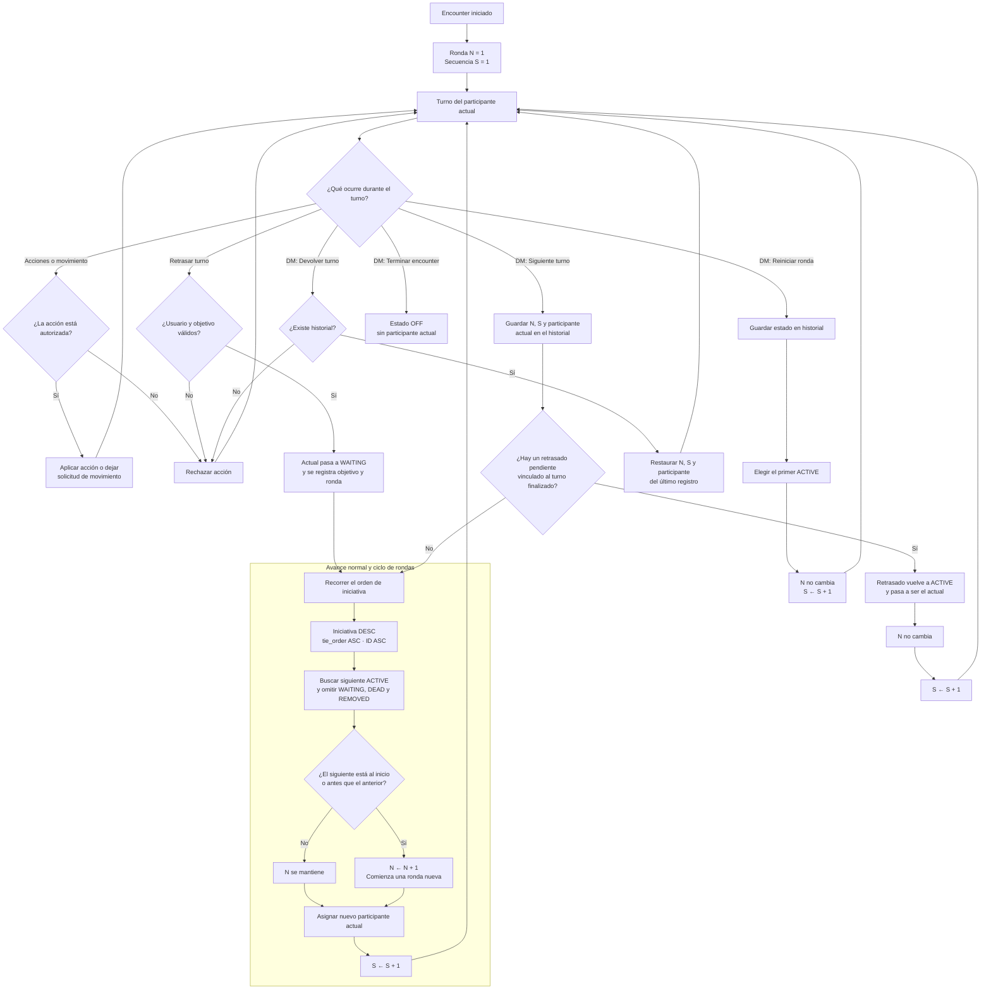

# Flujo del sistema de turnos

Este diagrama representa el comportamiento actual del sistema una vez que el encounter ya está en estado `RUNNING`.

## Reglas del ciclo

- El orden normal es iniciativa descendente, seguido de `tie_order` e ID ascendentes.
- Solo los participantes con estado `ACTIVE` reciben un turno normal.
- El DM es quien ejecuta `turn.next`, `turn.rollback` y `encounter.restart_round`.
- Un jugador puede ejecutar `turn.delay` únicamente durante el turno de uno de sus personajes.
- Si el objetivo del retraso aparece antes o en la misma posición que el participante actual, el retraso se agenda para la ronda siguiente.
- `turn_sequence` aumenta con cada avance y sirve como contador absoluto; `round_no` solo aumenta al volver al inicio del orden.
- Durante `RUNNING`, el servidor rechaza el movimiento de un personaje que no tenga el turno actual.

## Persistencia y sincronización

Cada comando se procesa dentro de una transacción en `GameService`. Tras aceptarlo:

1. Se actualiza el estado del encounter en MariaDB.
2. Se incrementa `scenarios.version`.
3. Se registra el evento y el recibo idempotente del `requestId`.
4. WebSocket envía `refresh` a los clientes del escenario.
5. Cada cliente solicita un snapshot nuevo y vuelve a renderizar el turno actual.

> Nota: el diagrama documenta la implementación actual. Devolver un turno restaura participante, ronda y secuencia, pero actualmente no revierte los cambios realizados en `turn_delays` ni los estados `WAITING`/`ACTIVE` asociados.
